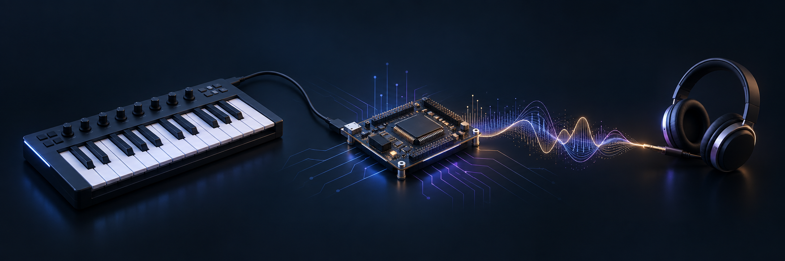
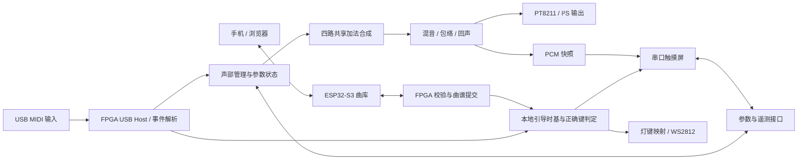

<div align="center">

# 弦域 · Xianyu

**用 FPGA 逐样本生成声音，把演奏、表情控制与旋律练习连在一起。**

[](docs/HARDWARE.md)
[](rtl/audio)
[](firmware/esp32s3_score_bridge)
[](LICENSE)

[快速开始](docs/BUILD.md) · [硬件连接](docs/HARDWARE.md) · [实现与验证](docs/VERIFICATION.md) · [作者与许可](AUTHORS.md)

</div>



> 封面为 AI 生成的概念插图，不是实物照片或接线图。系统接口以约束文件及硬件文档为准。

弦域是一套基于高云 FPGA 的实时多音色电子乐器原型，面向实时演奏和旋律学习。USB MIDI 输入触发 FPGA 内部声部管理、加法合成、包络与混音；串口触摸屏负责参数操作和运行反馈；ESP32-S3 提供局域网曲库管理；可编程灯带提示目标琴键和节奏。

本仓库是经过整理的**非商业公开源码版**，采用独立历史。包含主要 RTL、测试平台、S3 固件与网页源码。它不是比赛资料、第三方歌曲或整套硬件生产文件的镜像。非商业限制意味着本项目不属于 OSI 定义的开源软件；具体授权以 [LICENSE](LICENSE) 为准。

## 能做什么

| 能力 | 实现 |
|---|---|
| 实时合成 | 32 声部，每声部 8 分量；独立声部状态，四路共享运算流水线 |
| 音色与表情 | 风琴、钟铃、拨弦、类钢琴；力度/固定力度、弯音、颤音、ADSR、回声 |
| USB 演奏 | FPGA 接收 USB MIDI；当前 Host 针对已验证设备配置，非通用 USB 音乐设备驱动 |
| 触摸交互 | 音色、音量、包络参数、曲谱引导、PCM 快照和诊断；音频与显示独立握手 |
| 无线曲库 | S3 热点或 2.4 GHz 局域网网页；四个常驻槽、查询、暂存、校验与提交 |
| 灯带练习 | 按节奏推进、等待正确琴键两种模式；键位→灯号查表校准 |
| 音频输出 | 板载 PT8211 通路；另含标准 I²S 发送 RTL，外置 DAC 验收状态单列 |

声音由 FPGA 根据音符和控制事件计算生成。S3 传输的是符号曲谱和元数据，不传输预录 PCM 音频。引导谱用于提示练习，不等同于自动伴奏播放器。

## 系统如何协同



## 从源码开始

无需接板即可运行 RTL 合约回归。准备 Python 3 与 Icarus Verilog：

```sh
python scripts/run_review_regressions.py --mode fixed
```

准备主机 GCC 后，可检查 S3 四槽事务：

```sh
python scripts/test_s3_resident_slots.py
python firmware/esp32s3_score_bridge/tests/test_catalog.py
```

S3 使用 ESP-IDF 6.1，网页为 React / TypeScript / Vite；FPGA 使用 Gowin 工具链。目标构建、网页打包和设备部署步骤见 [构建说明](docs/BUILD.md)。脚本中的离线测试不会自动烧录设备。

## 代码导航

| 目录 | 内容 |
|---|---|
| [`rtl/audio`](rtl/audio) | 声部状态、合成、包络、回声及音频发送 |
| [`rtl/usb_host`](rtl/usb_host) | USB Host 与 MIDI 输入，含上游 Apache-2.0 代码 |
| [`rtl/ui`](rtl/ui) | 串口屏、曲谱事务、双模式引导、灯带与遥测 |
| [`rtl/boards/mega60k`](rtl/boards/mega60k) | 顶层、管脚约束、时序约束与 Tcl |
| [`rtl/tb`](rtl/tb) | RTL 仿真测试平台 |
| [`firmware/esp32s3_score_bridge`](firmware/esp32s3_score_bridge) | S3 固件、HTTP 接口、网页与主机测试 |
| [`scripts`](scripts) | 构建准备、回归与网页资源打包 |
| [`docs`](docs) | 接线、验证范围及公开版说明 |

## 实现记录

既有完整实板构建的采样率为 **48,828.125 Hz**，每音频帧 1,024 个 50 MHz 系统时钟；四流水线核心计算预算为 384 周期。记录的 CLS 占用为 **91.376%**，最差 Setup 余量为 **+0.015 ns**，因此资源和时序余量仍需谨慎管理。

这些是已记录的完整工程数据，并非本公开快照重新完成布局布线后的结果。约 380 μs 的示波器观察值受测量端点和配置约束，不能直接表述为所有物理按键到声音的最坏延迟。详细口径与本次离线测试结果见 [验证记录](docs/VERIFICATION.md)。

## 曲谱与屏幕资源

公开版内置一份原创单音练习，保留自定义 XS01 曲谱接口。第三方 MIDI、歌曲改编数据、试听音频、个人竞赛报告、厂商安装包与历史构建产物不在发布范围内。

串口屏需要与 FPGA 协议配套的工程。本版公开屏端接口的 RTL 实现，**尚未附带可直接烧录的 HMI/TFT 工程**，因此不能仅凭本仓库复现完整屏幕界面。勿将网页 HTML 当作陶晶驰屏幕固件。参见 [公开版范围](docs/RELEASE_SCOPE.md)。

## 作者与使用

由 [RickSanchezC5163](https://github.com/RickSanchezC5163) 与 [CAOH1024](https://github.com/CAOH1024) 共同贡献。完整说明见 [AUTHORS.md](AUTHORS.md)。

项目自有源码与文档采用 **CC BY-NC-ND 4.0**。第三方代码保留原许可，不受本项目重新许可；见 [第三方声明](THIRD_PARTY_NOTICES.md) 和 [USB Host 声明](rtl/usb_host/README.md)。允许署名、非商业地分享原始内容；未经另行授权，不得传播改编版本。商业用途或改编版分发请联系作者取得另行授权。历史版本说明见 [许可说明](docs/LICENSING.md)。

反馈问题时请提供板卡版本、构建版本、连接方式、复现步骤与日志；不要提交 Wi-Fi 密码、访问令牌或其他私人信息。
